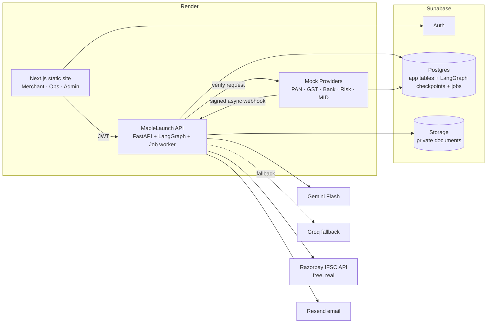
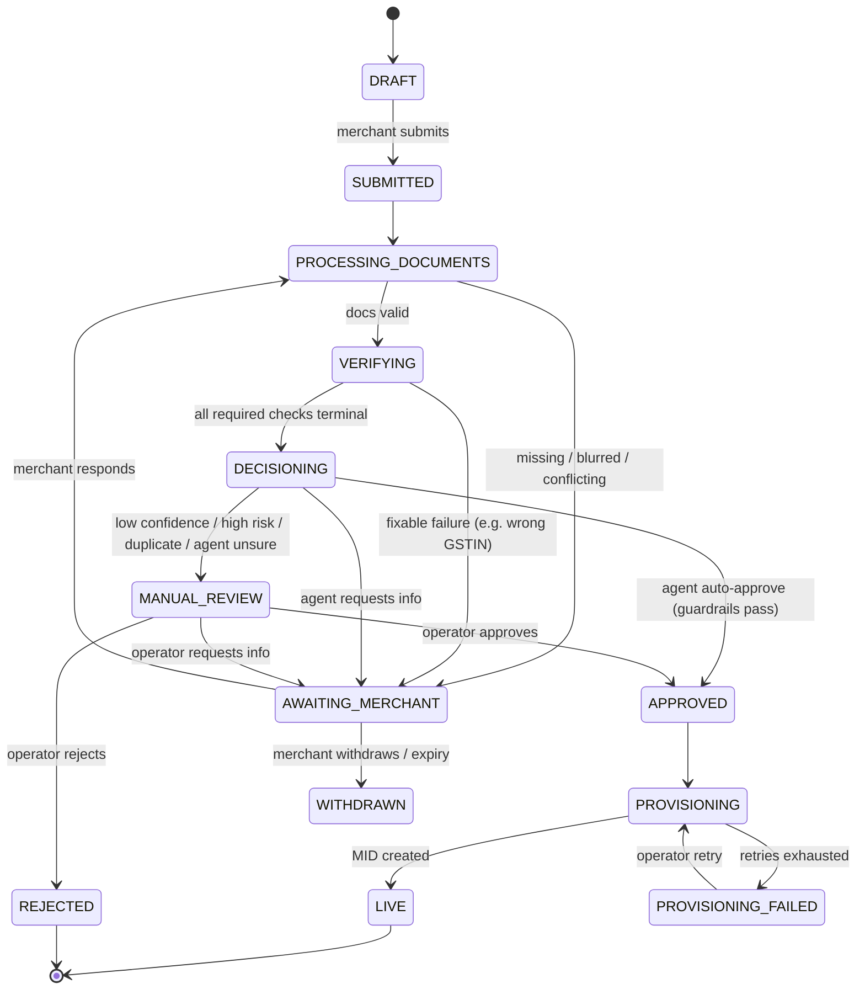

# MapleLaunch: Build Plan

**Autonomous Merchant Onboarding Platform** · Pine Labs Early Talent Program ("First Prompt") · Challenge 01

Deliverables required by Pine Labs: a **public GitHub repository** and a **short demo video**. Time budget: **48 hours**.
Goal: a coherent, deployed, end-to-end vertical slice, with assumptions, mocks and limitations stated clearly.

---

## The whole project in one diagram

```mermaid
%%{init: {"theme":"base","themeVariables":{"clusterBkg":"#FAFAFA","clusterBorder":"#D4D4D8","lineColor":"#71717A","fontSize":"15px"}}}%%
flowchart TD
  subgraph L["Request-info loop, used wherever you see ↺"]
    L1["AI drafts a specific request → in-app inbox and email<br/>merchant replies → back to step 2, only affected checks re-run<br/>no reply for N days → Withdrawn"]
  end

  subgraph M["1 · Merchant portal"]
    A1([Merchant signs in]) --> A2["Choose business type<br/>Proprietorship · Partnership · Pvt Ltd"]
    A2 --> A3["Upload documents<br/>checklist adapts to business type"]
    A3 --> A4["AI autofill<br/>Gemini, Groq as fallback"]
    A4 --> A5["Review fields<br/>confidence badge on each"]
    A5 --> A6["Bank details<br/>live IFSC lookup"]
    A6 --> A7[Consent and submit]
  end

  subgraph D["2 · Document intelligence"]
    B1["Extract fields and quality score"] --> B2{"Legible and the<br/>right document?"}
    B2 -- no --> RQ1[["↺ Ask merchant to re-upload"]]
    B2 -- yes --> B3["Validate: completeness, PAN and GSTIN<br/>format and checksum, cross-document names"]
    B3 --> B4{Consistent with form?}
    B4 -- no --> RQ2[["↺ Ask merchant to confirm or fix"]]
    B4 -- yes --> B5["Duplicate and entity matching<br/>matches flagged for the decision"]
  end

  subgraph V["3 · Parallel verification, asynchronous"]
    C0["Dispatch checks<br/>idempotency key and deadline"]
    C0 --> P1[PAN] & P2[GST] & P3[Bank penny-drop] & P4[Risk score]
    P1 & P2 & P3 & P4 --> W["Workflow paused<br/>waiting for callbacks"]
    W -- "signed webhook arrives" --> C2{Callback check}
    C2 -- "duplicate · late and superseded · bad signature" --> C2x["Logged, not applied"]
    C2 -- valid --> C3[Update check result]
    C3 --> C4{All 4 checks done?}
    C4 -- no --> W
    W -- "deadline passed" --> T2{Retries left?}
    T2 -- yes --> C0
    T2 -- "no: check marked ERROR" --> C4
  end

  DE{{"4 · Decision engine<br/>AI agent inside policy guardrails"}}

  subgraph H["5 · Human review queue"]
    H1["Operator sees AI summary, risk explanation,<br/>document vs form diff, duplicates"] --> H2{Reviewer decision}
    H2 -- "request info" --> RQ4[["↺ Ask merchant"]]
    H2 -- reject --> X1(["Rejected<br/>reason sent to merchant"])
  end

  subgraph P["6 · Activation"]
    F1[Approved] --> F2["Create Merchant ID<br/>idempotent"]
    F2 --> F3{Created?}
    F3 -- yes --> F4(["Merchant LIVE<br/>MID issued, merchant notified"])
    F3 -- "fails after 3 auto-retries" --> F5["Provisioning failed<br/>ops exception"]
    F5 -- "operator retries" --> F2
  end

  subgraph G["7 · After go-live"]
    G1[Merchant changes bank details] --> G2["Bank check invalidated<br/>payouts on hold"]
    G2 --> G3{Re-verified?}
    G3 -- yes --> G4[Payouts resumed]
    G3 -- no --> G5[["→ Human review"]]
  end

  A7 --> B1
  B5 --> C0
  C4 -- yes --> DE
  DE -- "all checks pass, low risk,<br/>high confidence, no duplicates" --> F1
  DE -- "fixable issue, e.g. wrong GSTIN" --> RQ3[["↺ Ask merchant for a fix"]]
  DE -- "uncertain · mismatch · high risk<br/>duplicate · critical failure" --> H1
  H2 -- approve --> F1
  F4 -.-> G1

  classDef merchant fill:#EFF6FF,stroke:#3B82F6,color:#1E3A8A
  classDef system fill:#FFFFFF,stroke:#71717A,color:#18181B
  classDef ai fill:#F5F3FF,stroke:#7C3AED,color:#4C1D95
  classDef human fill:#FFFBEB,stroke:#D97706,color:#78350F
  classDef good fill:#ECFDF5,stroke:#059669,color:#064E3B
  classDef bad fill:#FEF2F2,stroke:#DC2626,color:#7F1D1D
  classDef loop fill:#FFF7ED,stroke:#EA580C,color:#7C2D12
  class A1,A2,A3,A5,A6,A7,G1 merchant
  class B2,B3,B4,B5,C0,P1,P2,P3,P4,W,C2,C3,C4,T2,F2,F3,G2,G3 system
  class A4,B1,DE ai
  class H1,H2,F5,G5 human
  class F1,F4,G4 good
  class X1,C2x bad
  class L1,RQ1,RQ2,RQ3,RQ4 loop
```



<details><summary>Mermaid source (also in docs/flow.mmd)</summary>



</details>

**How to read it:** blue = merchant, purple = AI, white = system, amber = human operator, green = success, red = stop or rejected, orange **↺** = the request-info loop.
- **Only a human can reject.** The decision engine may approve, request information, or escalate. Critical failures go to the review queue flagged "recommend reject".
- **All four checks run in parallel.** The workflow pauses until their callbacks arrive.
- **One request-info loop (↺)** is shared by four triggers: a blurred or wrong document, a conflict with the form, a fixable verification failure, and a reviewer asking for information. The merchant's reply re-enters step 2, and only the affected checks are re-run.

---

## 1. Decisions locked in

| Area | Decision |
|---|---|
| Languages | **Python 3.12** (backend, workflow, mock providers, scripts) · **TypeScript** (frontend) · SQL (Postgres) |
| Backend | FastAPI + Pydantic v2 + SQLAlchemy 2 (async) + Alembic |
| Workflow engine | **LangGraph**, saved to Postgres after each step (durable checkpoints, `interrupt()` for async waits and human review) |
| Frontend | Next.js (App Router, static export) + Tailwind + shadcn/ui + TanStack Query + react-hook-form/zod |
| LLM | **Gemini Flash primary → Groq (Qwen vision / GPT-OSS) fallback** → deterministic/manual fallback |
| Auth | Supabase Auth (email/password) + roles `merchant` / `operator` / `admin`, seeded demo accounts with one-click login |
| Database / files | Supabase Postgres + Supabase Storage (private bucket, short-lived signed URLs) |
| Hosting | **Render** (frontend as a Static Site, API and mock providers as free Web Services) + **Supabase** |
| Merchant UX | Step-by-step wizard: upload documents → AI autofills the form with confidence badges → merchant confirms |
| Async simulation | **Separate mock-provider service** that sends signed webhooks, plus an admin **scenario control panel** |
| AI role | **AI agent decides routine cases**, inside hard guardrails enforced by the policy engine |
| Rejection | **Humans only.** Critical failures (invalid PAN, cancelled GSTIN, etc.) go to the review queue flagged "recommend reject"; nothing is rejected automatically |
| Check order | **PAN, GST, Bank and Risk all dispatched in parallel**; the workflow waits for all four callbacks |
| Risk | Rule-based score from signals + LLM plain-language explanation |
| Approval rules | **Admin policy page**: required checks per business type and thresholds, versioned in the database |
| Business types | Proprietorship, Partnership, Private Limited (a config-driven document checklist for each) |
| Stretch features in scope | **Human review queue (HITL)**, **duplicate detection and entity matching** |
| Out of scope (stretch) | Full dead-letter-queue UI, ops metrics dashboard. Minimal bounded retries stay in, because the failure scenarios require them. A small stat strip in the ops console is kept. |
| PII | Encryption at rest (AES-GCM) + masking + role-gated "reveal" (audit-logged) + log redaction + blind indexes for matching |
| Notifications | In-app Requests inbox + email via Resend (free tier) |
| Brand | Own **MapleLaunch** identity: maple-leaf mark, warm maple-red accent on a clean neutral, minimal UI |

---

## 2. Architecture



**Why this shape**
- **No Redis or queue service.** Background work uses a Postgres **`jobs` table** (`SELECT … FOR UPDATE SKIP LOCKED`) polled by a worker loop inside the API process. Timers (callback deadlines, retry backoff) are jobs with a `run_at`. Everything survives restarts because it lives in the database.
- **Two sources of truth, kept separate:**
  1. `applications.status` is the **explicit state machine**: a transition table plus guards, validated in code, with every change written to `state_transitions` and `audit_log`.
  2. The **LangGraph checkpoint** records *where the workflow is* (which node, what it is waiting for). Nodes may only change application state through the state-machine module, never directly.
- The **mock providers** run as a separate service with their own schema (`mock.*`), so the integration boundary is a real one: HTTP requests, `202 Accepted`, then signed webhook callbacks.
- **Render free-tier caveat:** services sleep after about 15 minutes idle, with a 30-50 s cold start. Mitigations: the frontend is a static site (it never sleeps); on wake-up the worker processes overdue jobs first; a free cron (GitHub Actions schedule or cron-job.org) pings `/healthz` every 10 minutes during demo windows; the UI shows a "waking up services…" banner.

---

## 3. Application state machine



- Implemented as a `TRANSITIONS: dict[State, set[State]]` table plus guard functions. Illegal transitions raise errors and are covered by table-driven tests.
- `applications.version` provides **optimistic locking**, which prevents two operators or two callbacks from clobbering each other.
- **Time in state** comes from `status_changed_at` and is shown in the ops console with SLA colouring.

**Per-check sub-state** (`verification_checks`, one row per check per attempt):
`REQUESTED → PENDING → PASSED | FAILED | TIMED_OUT | ERROR`, plus `INVALIDATED` (the input changed after verification). Status moves only forward within an attempt, so an out-of-order "pending" callback after "passed" is ignored.

---

## 4. LangGraph workflow

One graph per application (`thread_id = application_id`), saved with `AsyncPostgresSaver` on Supabase.

```
ingest → extract → validate → dedupe → dispatch_verifications ─┐
                                                               ▼
                                         await_callbacks (interrupt) ◄── resumed by webhook / timeout jobs
                                                               ▼
                                         agent_decide (tool-calling agent + guardrails)
                                         ├─ request_info  → notify → interrupt (wait for merchant) → extract …
                                         ├─ retry_check   → dispatch_verifications
                                         ├─ escalate      → human_review (interrupt; operator decision resumes)
                                         └─ approve       → provision_mid (idempotent, retries) → notify → END
```

| Node | Behaviour |
|---|---|
| `extract` | Multimodal LLM call for each document → Pydantic schema: `{field: {value, confidence, source_doc}}` plus `quality: {blur, cropped, legible}` and `doc_type_detected`. PDFs are rasterised with `pypdfium2` for the Groq fallback. If both LLMs fail → mark "manual entry needed" and route to AWAITING_MERCHANT / review. |
| `validate` | **Deterministic**: checklist completeness per business type; PAN format **and 4th-character entity type** (P = proprietor, F = firm, C = company); GSTIN format + **mod-36 checksum** + **embedded PAN must equal the PAN**; IFSC lookup via the free Razorpay IFSC API; cross-document consistency (form vs PAN vs GST vs bank) using `rapidfuzz` name matching. |
| `dedupe` | Blind-index exact matches on PAN, GSTIN, bank account and phone/email, plus fuzzy business name + address. Produces `duplicate_matches` with a score. |
| `dispatch_verifications` | Parallel fan-out (LangGraph `Send`) to the PAN, GST, Bank penny-drop and Risk providers. Each call carries an idempotency key and gets `202 {request_id}`. A `check_timeout` job is scheduled at the deadline. |
| `await_callbacks` | `interrupt()`. Resumed only when every required check is in a terminal state. |
| `agent_decide` | See guardrails below. Every decision is stored with reasoning, model name and prompt version. |
| `human_review` | `interrupt()`. Creates a `review_tasks` row with an AI-written summary. The operator's action resumes the graph with `Command(resume=…)`. |
| `provision_mid` | Calls the mock MID service with `idempotency_key = application_id`. On timeout it **queries status before retrying**, so no duplicate MIDs are created. Up to 3 attempts with exponential backoff, then PROVISIONING_FAILED + an ops exception. |

**Resuming safely:** a webhook handler never runs the graph itself. It records the event and enqueues a `resume_workflow(app_id)` job. The worker takes a **Postgres advisory lock per application** before resuming, so concurrent callbacks are serialised.

### Agent guardrails ("AI decides routine cases")
- Tools: `request_merchant_info(fields, message)`, `retry_check(check)`, `escalate_to_review(reason, summary)`, `approve_application(justification)`.
- `approve_application` **only executes if the policy engine's `can_auto_approve()` returns true**: every required check `PASSED` on its current attempt, risk ≤ the auto-approve threshold, every key field's confidence ≥ the threshold, no open duplicate match, no unresolved conflict, and the category is not on the high-risk list. Otherwise the tool returns an error and the agent must escalate.
- **No auto-reject, by anyone.** Neither the agent nor the rules engine rejects. Critical failures (PAN invalid or deactivated, GSTIN cancelled with no fix possible, match with a blocked merchant) are escalated to the review queue with priority and a "recommend reject" flag plus the reason; the operator makes the call.
- The agent sees **structured fields and check results only, never raw document text**. This mitigates prompt injection through uploaded documents.
- Step limit (6 tool calls). If the LLM is unavailable, a deterministic router makes the same decision from the rules.

---

## 5. Failure and exception scenarios → handling

| # | Scenario | Handling | Where it is visible |
|---|---|---|---|
| 1 | **PAN passes, GST fails** | The PAN result is kept, and only GST is re-run after a fix. Failure reasons are classified: *GSTIN not found / cancelled* → agent requests a corrected GSTIN or certificate (AWAITING_MERCHANT); *legal-name mismatch* → MANUAL_REVIEW; *provider error* → retry. The policy can allow "GST-exempt declaration" for proprietorships below the turnover threshold. | Check panel shows partial pass; Requests inbox |
| 2 | **Same callback arrives multiple times** | `callback_events` has a unique key on `(provider, event_id)`, enforced with insert-on-conflict-do-nothing. Duplicates return `200 {"status":"duplicate"}` and change nothing. HMAC signature + timestamp window (±5 min) blocks replays. | Timeline entry "duplicate callback ignored" |
| 3 | **Callback after the request timed out** | At the deadline the check moves to `TIMED_OUT` → a retry with a **new attempt and request_id** (up to 2), then an exception. A late callback is matched by request_id: if its attempt is still current and unresolved, it is **accepted** (the late result wins and the retry is cancelled); if it has been superseded, it is **recorded as late and stale, but not applied**. | Timeline shows "late callback (attempt 1, superseded)" |
| 4 | **Merchant changes bank details after verification** | Allowed only through a *change request*. The old bank check becomes `INVALIDATED` and a new penny-drop is dispatched. If the application is already APPROVED/LIVE: `payouts_on_hold = true` until re-verified, and a bank change soon after approval adds a risk signal that sends it to review. Every step is audited. | Banner "Bank re-verification in progress" |
| 5 | **Approval succeeds but MID creation fails** | Approval is **not** revoked. An idempotent retry checks status first, uses backoff and makes 3 attempts. When exhausted → PROVISIONING_FAILED + an ops exception with a "Retry provisioning" button. | Ops exceptions list |
| 6 | **Document blurred / conflicts with the form** | The LLM quality score is below threshold → a specific re-upload request ("PAN card image is blurred: please upload a clearer photo"). For a conflict, the side-by-side diff shows form vs document: fuzzy ≥ 90% is accepted with a note; anything else means the merchant confirms or it goes to review. | Wizard highlights; review screen diff |

**Additional edge cases handled:** provider outage (5xx or connect timeout on the request → bounded retry → `ERROR` → exception); LLM rate-limit or outage (Groq fallback → manual path); invalid webhook signature (401 + security audit entry); out-of-order callbacks (status only moves forward); a merchant editing while VERIFYING (fields locked; changes only through a change request); two operators acting at once (optimistic-lock conflict → "refresh" toast); the same file uploaded across applications (SHA-256 file hash → duplicate signal); wrong document in a slot (`doc_type_detected` ≠ slot → re-upload request); entity-type mismatch (a company applying with a personal PAN); an abandoned application (AWAITING_MERCHANT for N days → reminder, then WITHDRAWN); a check that is not required by policy (skipped and recorded as `NOT_REQUIRED`).

---

## 6. Mock providers and scenario controls

Separate FastAPI service (`apps/mock_providers`):

| Endpoint | Callback payload (sent 2-8 s later, HMAC-signed) |
|---|---|
| `POST /pan/verify` | name on PAN, status (valid / invalid / deactivated), entity type |
| `POST /gst/verify` | legal name, trade name, status (active / cancelled), registration date, state |
| `POST /bank/penny-drop` | account valid, beneficiary name (for name match) |
| `POST /risk/assess` | score 0-100 + signals (category, GST age, mismatches, duplicates, bank change) |
| `POST /mid/create`, `GET /mid/{idempotency_key}` | synchronous; MID like `MLN-XXXXXXXX` |

**Scenario control panel (admin):** per provider, set *success / fail / duplicate ×3 / delay past timeout / outage (503) / never call back / out-of-order*, either globally or for one application. **Magic test values** (like Stripe test cards) make scenarios reproducible, e.g. a GSTIN ending in `9Z9` → cancelled, an account number `000…0` → invalid.

**Seeded demo personas**, each with generated sample documents:
1. Happy path, proprietorship (auto-approved by the agent)
2. GST fails (cancelled) → info request → fixed → approved
3. Blurred PAN → re-upload
4. Name mismatch with the bank → manual review
5. Duplicate of an existing merchant → review
6. High-risk category → review → operator approves → **MID failure → retry → LIVE**

**Sample documents:** `scripts/generate_samples.py` (Pillow / ReportLab) generates synthetic PAN cards, GST certificates, cancelled cheques, certificates of incorporation and partnership deeds as PNG/PDF, each with a clear **"SPECIMEN - SYNTHETIC"** watermark, no government emblems, and blurred and conflicting variants.

---

## 7. Data model (Postgres)

| Table | Purpose |
|---|---|
| `profiles` | user_id (Supabase), role, display name |
| `applications` | id, merchant_user_id, business_type, status, version, form_data (non-sensitive jsonb), risk_score, decision, decided_by (agent/operator), mid, payouts_on_hold, status_changed_at |
| `application_pii` | encrypted PAN, GSTIN, account number, phone, email (AES-GCM) + **blind indexes** (HMAC-SHA256) for matching without decrypting |
| `documents` | slot type, storage path, sha256, mime, quality, detected type, status |
| `extractions` | per document: fields jsonb (value, confidence), model, prompt version, latency |
| `validation_results` | rule, outcome, details |
| `verification_checks` | type, attempt, status, request_id, idempotency key, deadline, result jsonb, is_current |
| `callback_events` | provider, event_id (unique), signature valid, late / duplicate / stale flags, raw payload (PII-masked) |
| `state_transitions` | from, to, actor (system / agent / operator / merchant), reason, timestamp |
| `audit_log` | append-only, **hash-chained** (each row stores the previous row's hash → tamper-evident); includes PII reveals |
| `review_tasks` | reason, AI summary, assignee, status, decision |
| `info_requests` | requested fields/documents, message, status |
| `duplicate_matches` | matched application, matched keys, score, resolution |
| `notifications` | in-app inbox + email delivery status |
| `policies` | versioned jsonb (required checks per business type, thresholds, high-risk categories); the active version id is stamped on each decision |
| `jobs` | type, payload, run_at, attempts, status, last_error |
| `mock.*` | scheduled callbacks and scenario config for the mock service |

---

## 8. Security and responsible PII handling

- **Data minimisation:** no Aadhaar is collected. PAN plus business documents are enough for the slice.
- **Encryption at rest:** PAN, GSTIN, account number and contact details are encrypted with AES-GCM using a key in a Render environment variable. Blind indexes allow duplicate detection.
- **Masking everywhere:** `ABCDE••••F`, `••••••3456`. The full value appears only through an operator **"Reveal"** action, which asks for a reason and is audit-logged.
- **Logs:** a structlog redaction processor masks PAN, GSTIN, account and email patterns.
- **Documents:** private Supabase bucket, signed URLs valid for 60 s, access checked by role and ownership.
- **Webhooks:** HMAC-SHA256 signature + timestamp, rejecting stale or replayed requests.
- **Authorisation:** FastAPI verifies the Supabase JWT and enforces roles; merchants see only their own applications.
- **LLM data notice:** Gemini and Groq **free tiers may use inputs to improve their services**, so the app shows a **"Demo: upload synthetic documents only"** banner and ships the synthetic samples. Production would use paid, no-retention endpoints. This is stated in the README.
- **Explainability:** every automated decision records the policy version, check results, agent reasoning and model.

---

## 9. User experience (simple and smooth)

**Brand:** MapleLaunch maple-leaf mark; neutral zinc/stone base; one maple-red accent (≈ `#D9480F`); Inter font; generous whitespace; rounded-xl cards; subtle motion. Status colours: green = passed, amber = pending or needs attention, red = failed. Fully responsive.

**Merchant portal**
1. `/` landing → "Start application" / demo logins
2. **Wizard:** ① business type → ② upload documents (drag and drop; the checklist adapts to the business type) → ③ **review AI-filled details** (confidence badge per field, hover to see the source document, low-confidence fields highlighted) → ④ bank details (live IFSC → bank and branch lookup) → ⑤ consent and submit
3. **Status page:** live progress tracker (Documents → PAN → GST → Bank → Risk → Decision → MID) updating as callbacks arrive (polling every 2-3 s); **Requests inbox** with one-click responses (re-upload or correct a field); "Change bank details" as a change request; the MID shown when LIVE.

**Operator console**
- **Queue:** filter by state, exceptions only, SLA breach, assigned to me; small stat strip (counts per state, open exceptions).
- **Application detail:** timeline (state transitions, callbacks including duplicate and late markers, agent actions); checks panel; document viewer side by side with extracted fields and conflicts; AI summary, risk explanation and duplicate matches; actions: *Approve / Reject / Request info / Retry check / Retry provisioning / Reveal PII*.

**Admin**
- **Policy editor:** required checks per business type, confidence, risk and name-match thresholds, high-risk categories; save creates a new version.
- **Scenario lab:** controls for mock-provider behaviour plus "Run persona" buttons to seed a demo application.

---

## 10. Tech stack details

**Backend (Python, managed with `uv`):** fastapi, uvicorn, pydantic v2, sqlalchemy[asyncio], asyncpg, alembic, langgraph, langgraph-checkpoint-postgres, langchain-google-genai, langchain-groq, httpx, tenacity, rapidfuzz, cryptography, pypdfium2, pillow, resend, structlog, pyjwt · tests: pytest, pytest-asyncio, respx.
**Frontend (TypeScript):** next, react, tailwindcss, shadcn/ui, @tanstack/react-query, react-hook-form, zod, @supabase/supabase-js, lucide-react, sonner; **API types generated from FastAPI's OpenAPI schema** with `openapi-typescript`.
**Config:** the model name is an env var (`LLM_ORDER`, `GEMINI_MODELS`, `GROQ_VISION_MODEL`, `GROQ_TEXT_MODEL`), so current free-tier models can be swapped without code changes.

**Repository layout**
```
maplelaunch/
├─ apps/
│  ├─ web/                 # Next.js (TS): merchant, ops, admin
│  ├─ api/                 # FastAPI + LangGraph
│  │  └─ app/{core,db,models,schemas,state_machine,workflow,services,routers,jobs}
│  └─ mock_providers/      # FastAPI mock PAN/GST/Bank/Risk/MID
├─ scripts/                # generate_samples.py, seed.py
├─ samples/                # generated synthetic documents
├─ docs/                   # architecture, state machine, decisions, demo script
├─ render.yaml             # Render Blueprint (1 static site + 2 web services)
├─ .github/workflows/ci.yml   # lint, typecheck, tests (+ keep-alive cron)
├─ PLAN.md · README.md
```

**Free-tier limits to respect**
- **Render:** 750 free instance-hours per month shared by all services; sleeps when idle; 512 MB RAM (so no Tesseract or heavy OCR).
- **Supabase:** 500 MB database, 1 GB storage; the project **pauses after 7 days of inactivity**. Use the **session pooler** connection string, because Render cannot reach the IPv6-only direct connection.
- **Gemini / Groq:** per-minute request limits. Use a client-side throttle and fall back to the other provider on HTTP 429.
- **Resend:** about 100 emails per day; without a verified domain it can only send to the account owner's address, so demo emails go there. The in-app inbox is always the source of truth.

---

## 11. Testing

- **Unit:** state-machine transitions (legal and illegal, table-driven); PAN and GSTIN validators (including checksum); name matching; policy engine `can_auto_approve`; masking and encryption round-trip; webhook signature checks.
- **Integration (LLM stubbed, mock providers in-process):** one test per failure scenario in §5, plus the happy path end to end.
- **Manual demo checklist** for each persona on the deployed environment.

---

## 12. Build schedule (≈ 44 h + buffer)

| Phase | Hours | Output |
|---|---|---|
| 0. Scaffold and **deploy hello-world early** | 2 | Monorepo, Supabase project, Render Blueprint live, CI |
| 1. Core domain | 6 | Schema + migrations, auth and roles, state machine + tests, policy engine, audit log |
| 2. Integrations | 6 | Mock providers, signed webhooks, `jobs` worker, timeouts, idempotency, retries |
| 3. Document intelligence | 6 | Upload to storage, Gemini/Groq extraction, validators, IFSC lookup, sample generator |
| 4. Orchestration | 6 | LangGraph graph, checkpointer, interrupts, agent + guardrails, MID provisioning |
| 5. Frontend | 9 | Merchant wizard + status, ops console, admin policy + scenario lab |
| 6. Stretch and security | 4 | Duplicate detection, encryption/masking/reveal, notifications |
| 7. Hardening and storytelling | 5 | Scenario tests, seeding personas, README (assumptions, mocks, limitations, diagrams), demo video |

---

## 13. Demo video script (~4 min)

1. **Happy path (proprietorship):** upload → AI autofill with confidence → submit → watch PAN, GST, Bank and Risk callbacks arrive → agent auto-approves under the policy → MID issued.
2. **Exception path:** GST cancelled → agent requests a corrected GSTIN → merchant fixes it in the inbox → only GST is re-verified → approved.
3. **Resilience:** scenario lab sends a duplicate callback (ignored in the timeline) and a late callback (marked superseded).
4. **Human review:** high-risk merchant → AI summary → operator approves → MID creation fails → automatic retries → "Retry provisioning" → LIVE.
5. **Responsible handling:** masked PII, audited reveal, hash-chained audit log, policy version stamped on each decision.

---

## 14. Assumptions, mocks and limitations (go into the README)

- PAN, GST, bank, risk and MID providers are **simulated**. The only real external lookups are the IFSC data (Razorpay's public API) and the LLMs.
- Indian onboarding context; KYC document requirements are simplified per business type; no Aadhaar or video KYC.
- Synthetic documents only (because of free-tier LLM data policies).
- A single API instance; a Postgres job queue instead of a broker; Render cold starts.
- Timeouts are shortened for demo purposes (e.g. 45 s instead of hours).
- No dead-letter-queue UI or full metrics dashboard (consciously descoped); bounded retries + exceptions cover the required failure paths.

---

## 15. Implementation notes (deviations from the plan above)

- **Parallel dispatch** uses `asyncio.gather` inside the `dispatch` node rather than LangGraph `Send`. The effect is
  the same (all four providers are called at once) with simpler checkpoint state.
- **Frontend types** are hand-written in `apps/web/src/lib/types.ts`. The API returns plain dicts, so generated
  OpenAPI types would have been untyped.
- **Local development** uses an embedded Postgres (`pgserver`, `DATABASE_URL=pgserver`) because Docker/WSL2 isn't
  available on the build machine. Production uses Supabase.
- **Auth** has two modes: `local` (built-in users, used for development and tests) and `supabase` (production). The
  frontend goes through `/auth/*` in both modes.
- **Extra beyond the plan:** dead-letter job list with replay, "Reset demo data" for reviewers, offline sample reader
  so the whole platform runs without API keys, post-go-live monitoring node (bank change after LIVE).
- **Demo vs production:** one codebase, two builds (`APP_MODE`, `NEXT_PUBLIC_APP_MODE`) and two Render Blueprints
  (`render.yaml`, `render.production.yaml`) with separate databases. Production drops all demo tooling and refuses
  to start with development secrets.
- **LLM order changed to Groq first.** Gemini 2.5 Flash's free tier allows only 20 requests per day, so Gemini is
  now a fallback list of models (each has its own quota). Rate-limited models cool down for 10 minutes, and an
  extracted identifier that fails its checksum makes the next model re-read the document.
- **Merchant withdrawal** is allowed at any point before approval, under the workflow's per-application lock.
