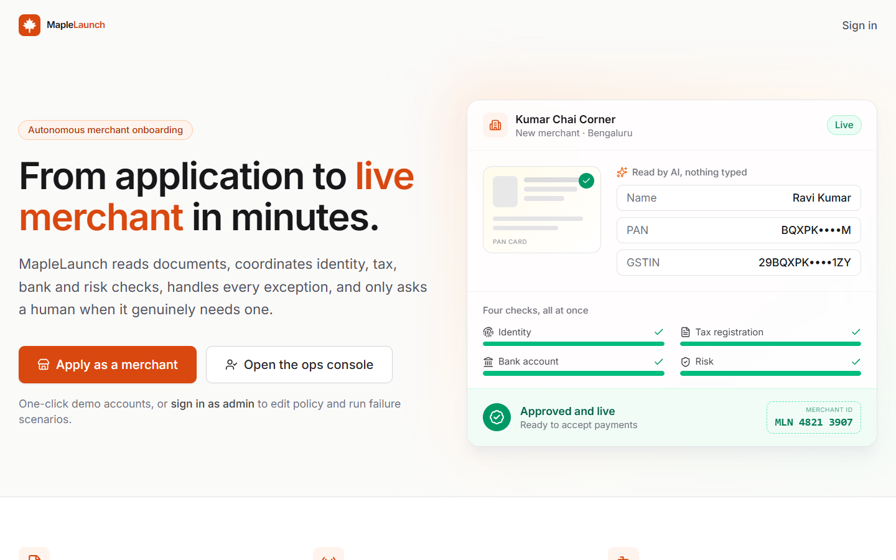
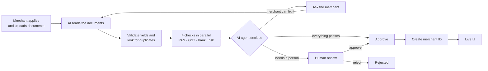
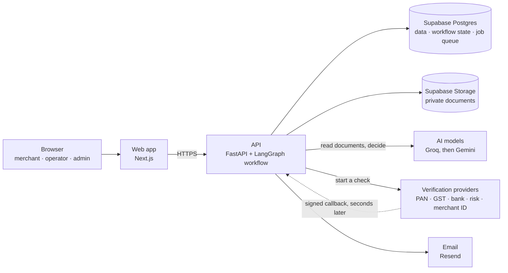
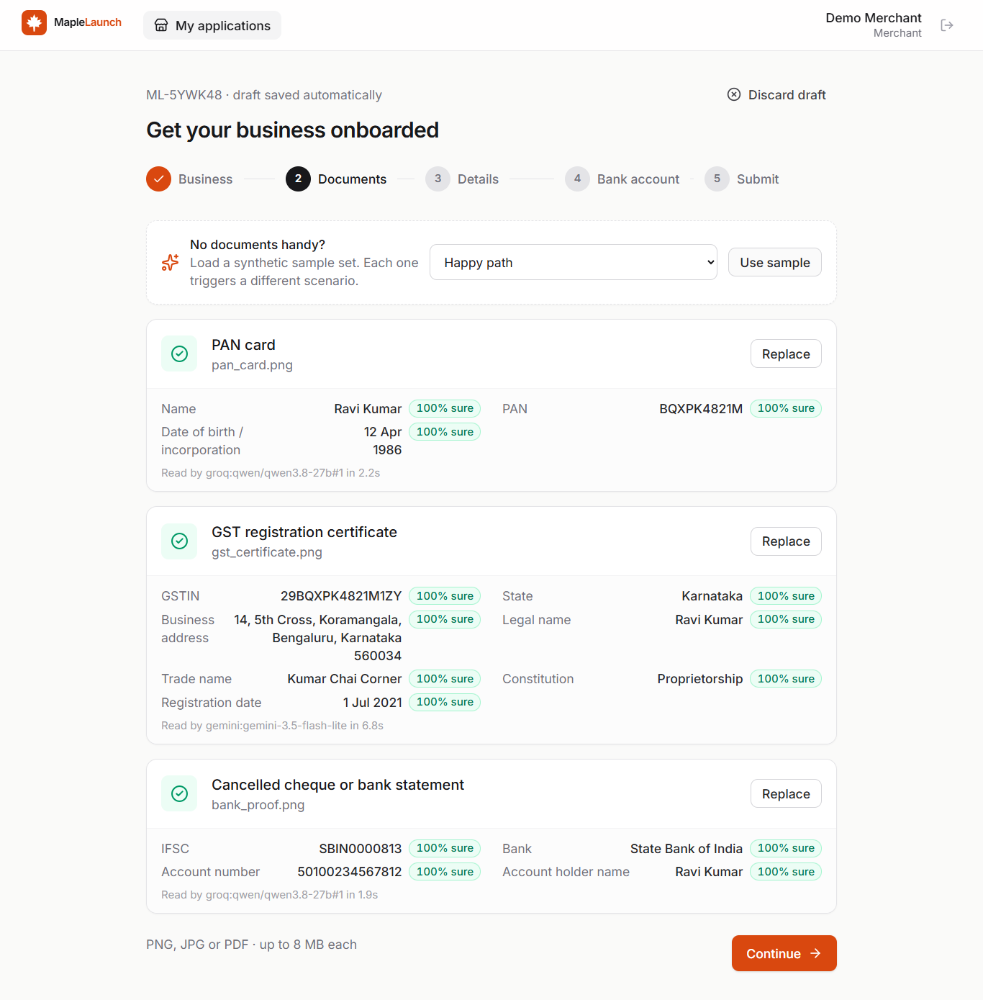
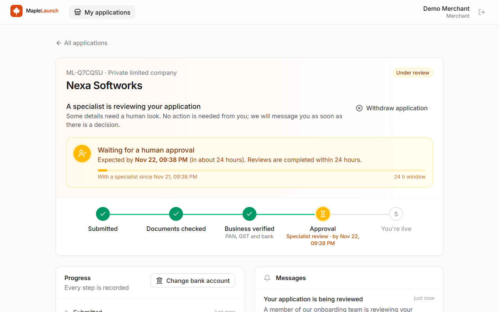
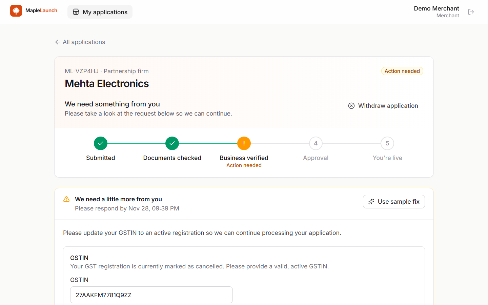
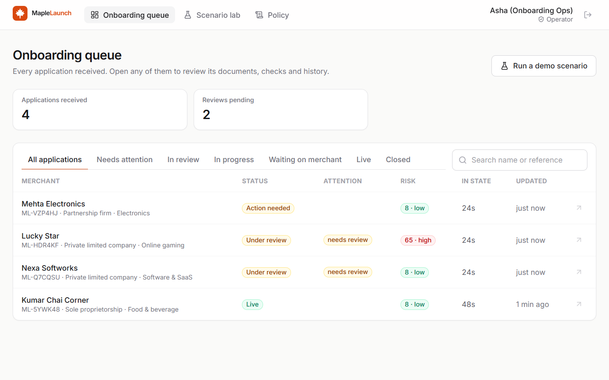

# 🍁 MapleLaunch

**Autonomous merchant onboarding.** A business applies and uploads its documents. AI reads them, four verifications
run in parallel, and an AI agent approves the merchant and issues a merchant ID. When it can't decide safely, it asks
the merchant for a fix or hands the case to a human reviewer.

Built for the Pine Labs *First Prompt* challenge (Case study 01). All merchants, documents and verification providers
are synthetic.

| | |
|---|---|
| **Live app** | **https://maplelaunch-web.onrender.com** |
| API docs (Swagger) | https://maplelaunch-api.onrender.com/docs |
| API health | https://maplelaunch-api.onrender.com/healthz |
| Video walkthrough | *(link)* |
| Design decisions | [PLAN.md](PLAN.md) · Deployment: [docs/DEPLOYMENT.md](docs/DEPLOYMENT.md) |

> The live app runs on free hosting. If it has been idle, the first page can take 30 to 60 seconds to wake up.



---

## Try it

On the **Sign in** page, pick a demo account from the dropdown. The email and password fill in for you.

| Account | What you can do |
|---|---|
| **Merchant** | Apply with sample documents, watch the AI fill in the form, track your application, answer requests, withdraw |
| **Operator** | See every application, review flagged ones with an AI briefing, approve, reject or ask the merchant, run scenarios in the **Scenario lab** |
| **Admin** | Everything an operator can, plus editing the approval policy, switching provider behaviour and resetting demo data |

Password for all three: `MapleLaunch@2026` (`merchant@example.com`, `operator@example.com`, `admin@example.com`).

A good first tour:

1. **Merchant:** *New application* → *Use sample* → watch the documents get read → submit. It goes live in about 30 s.
2. **Operator:** *Scenario lab* → run **Bank name mismatch**. It lands in the review queue.
3. Open it from the *Onboarding queue*, read the AI briefing and the side-by-side evidence, then **Approve**.

---

## How it works

### The journey



### The system



The ideas that make it work:

* **Each application is a paused workflow.** The workflow (LangGraph) saves its progress in Postgres after every
  step. While it waits for a provider, the merchant or a reviewer, it simply stops. A background job wakes it when
  the answer arrives, even after a server restart.
* **Checks are asynchronous, like real providers.** A check is started, and the result comes back later as a signed
  callback. Duplicate, late and out-of-order callbacks are recorded but never applied twice.
* **Status follows strict rules.** An application can only move between states the rulebook allows, and every move is
  logged in a tamper-evident audit trail.
* **The AI never has the last word on risk.** Code-level guardrails decide what the AI agent is allowed to do (below).

A more detailed diagram with every branch: [docs/flow.svg](docs/flow.svg).

---

## What it handles

Each of these is a one-click scenario in the **Scenario lab**:

| Scenario | What happens |
|---|---|
| **Happy path** | All checks pass. The PAN provider sends its result three times; the extra copies are ignored. Auto-approved and live. |
| **GST cancelled** | PAN and bank pass, GST fails. The merchant is asked for an active GSTIN and uploads it. **Only GST is re-checked.** |
| **Blurred PAN** | The photo is unreadable, so no provider is called. The merchant is asked for a clearer photo. |
| **Bank name mismatch** | The bank account belongs to a different name. Sent to a human with an AI summary. |
| **Duplicate merchant** | Same PAN and GSTIN as an existing merchant. Flagged for a human. |
| **High risk, then ID failure** | High-risk category, so a human approves. Merchant ID creation fails three times; the operator retries and it goes live. |
| **Late callback** | A provider misses its deadline, the check is retried, and the late answer is recorded as stale. |

Also handled: a merchant withdrawing mid-way, changing bank details after going live (payouts held until re-verified),
provider outages, bad webhook signatures, two operators acting at once, and the AI being unavailable.


---

## AI, with guardrails

* **Reading documents:** a vision model returns each field with a confidence score, plus a quality check (blur,
  cropping) and tamper flags. If a PAN, GSTIN, IFSC or CIN fails its own checksum, the read is rejected and another
  model tries.
* **Deciding:** the agent has only four tools: *approve*, *ask the merchant*, *retry a check*, *send to a human*.
  **It has no reject tool.** *Approve* works only if code confirms every required check passed and risk is low.
  It sees structured facts only, never raw document text.
* **Never stuck:** models are tried in order (Groq, then several Gemini models). If all are down, a rules engine makes
  the same decisions.
* **Explained:** every decision stores the model, the reasoning and what the rules engine would have done.

## Sensitive data

* PAN, GSTIN, account numbers, phone and email are **encrypted at rest** and **masked** in the operator view. Revealing
  one needs a reason and is audited.
* Documents sit in a **private bucket** and open through 60-second links.
* Provider callbacks are **HMAC-signed**; the audit log is **hash-chained**, so tampering shows.
* No Aadhaar is collected. Consent is recorded at submission.

---

## Requirements coverage

| The brief asked for | Where it is |
|---|---|
| Application with documents (image / PDF) | 5-step merchant wizard |
| Field extraction with confidence | AI reader, confidence badge on every field |
| At least 2 simulated verification services | 4 async providers + merchant-ID service (`apps/mock_providers`) |
| Explicit states and transitions | `apps/api/app/domain/states.py` |
| Asynchronous callbacks | Signed webhooks resume the paused workflow |
| Operator view | Queue plus a detail page with checks, evidence, timeline and audit |
| Approve only when checks pass | Policy guardrail, editable and versioned by the admin |
| **Stretch** | AI document reading · duplicate detection · durable workflow · human review queue · retries and dead-letter jobs · audit history · metrics |

---

## Run it locally

Needs [uv](https://docs.astral.sh/uv/) and Node 20+. No Docker and no API keys are needed: an embedded Postgres
starts by itself, and without AI keys a built-in sample reader and the rules engine take over.

```bash
# 1. API → http://localhost:8000
cd apps/api && cp ../../.env.example .env && uv sync && uv run python -m app.serve

# 2. Mock providers → http://localhost:8001 (new terminal)
cd apps/mock_providers && uv sync && uv run python -m mock.serve

# 3. Web → http://localhost:3000 (new terminal)
cd apps/web && echo "NEXT_PUBLIC_API_URL=http://localhost:8000" > .env.local && npm install && npm run dev
```

Add `GROQ_API_KEY` and/or `GEMINI_API_KEY` to `apps/api/.env` to use real AI.

```bash
cd apps/api && uv run pytest -q     # 36 unit tests
python scripts/e2e.py               # all 7 scenarios end to end, against the running stack
```

**Deploying:** two Render Blueprints, one for the demo (`render.yaml`) and one for production
(`render.production.yaml`, no demo tools, strict secrets). Step by step in [docs/DEPLOYMENT.md](docs/DEPLOYMENT.md).

## Limitations

* The verification providers and merchant-ID service are mocks. The IFSC lookup (Razorpay) and the AI models are real.
* Deadlines are shortened for the demo (45 s for a callback, 24 h promised for a human review).
* One API instance runs the background worker. It uses Postgres locks, so scaling out should work, but it was not
  load-tested.
* Payouts and settlements are simulated: "payouts on hold" is a flag, not a ledger.

## Repository layout

```
apps/api/             FastAPI API, LangGraph workflow, AI agent, state machine, tests
apps/mock_providers/  simulated PAN, GST, bank, risk and merchant-ID services
apps/web/             Next.js app: merchant portal, operator console, admin
scripts/e2e.py        end-to-end scenario runner
docs/                 diagrams, screenshots, deployment guide
```

<details><summary>More screenshots</summary>







</details>
