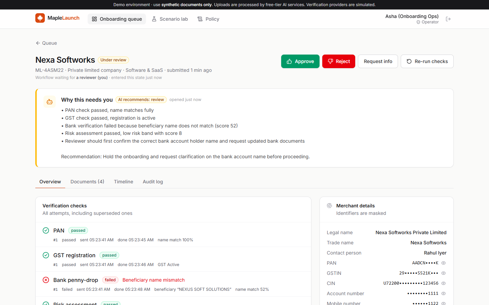
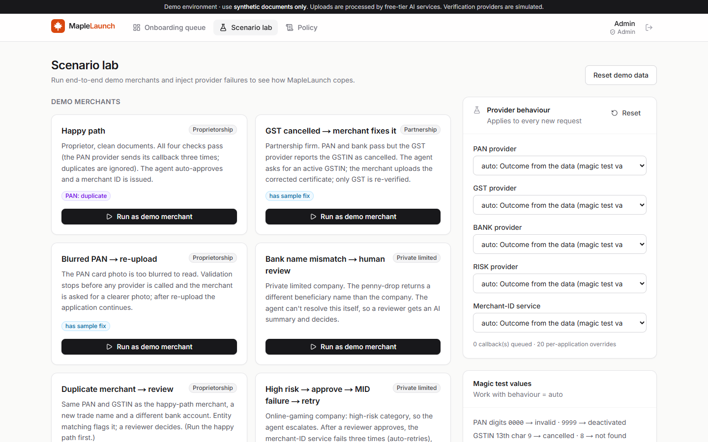

# 🍁 MapleLaunch: autonomous merchant onboarding

MapleLaunch takes a merchant from **application → document intelligence → asynchronous PAN / GST / bank / risk
verification → AI decision or human review → merchant-ID creation**, and handles the exceptions in between.

> Built for the Pine Labs *First Prompt* challenge: **Case study 01, Autonomous Merchant Onboarding Platform**.
> All merchants, documents and verification providers are synthetic.

| | |
|---|---|
| **Live demo** | `https://maplelaunch-web.onrender.com` *(fill in after deploy)*, with one-click demo accounts on the sign-in page |
| **Video walkthrough** | *(link)* |
| **Plan & design decisions** | [PLAN.md](PLAN.md) |



---

## Try it in two minutes

1. Open the app → **Open the ops console** (signs you in as the demo operator).
2. **Scenario lab** → run **Happy path**. In about 10 s it goes *Submitted → Verifying → Live* with a merchant ID. Open
   it: the PAN provider sent its callback 3 times and the timeline shows the duplicates being ignored.
3. Run **Bank name mismatch → human review**. The queue flags it. Open it to see the AI briefing, the
   evidence side by side and the masked PII (click 👁 to reveal; the reveal is audited). Then **Approve**.
4. Run **GST cancelled → merchant fixes it**, sign in as the **demo merchant**, open the application and use
   **Use sample fix** in the request card. Only the GST check re-runs.
5. Or apply as the merchant yourself: **New application → Use sample** to load synthetic documents, and watch the
   AI fill in the form.

Demo accounts: `merchant@example.com`, `operator@example.com`, `admin@example.com` (password `MapleLaunch@2026`).

---

## Demo and production builds

The same code builds two separate products, selected by `APP_MODE` (API) and `NEXT_PUBLIC_APP_MODE` (web):

| | Demo (`render.yaml`) | Production (`render.production.yaml`) |
|---|---|---|
| Accounts | One-click demo merchant, operator and admin | Merchant self-signup; first admin from `ADMIN_EMAIL` / `ADMIN_PASSWORD` |
| Sample documents, "Use sample fix" | Yes | No (the `/demo/*` routes are not mounted) |
| Scenario lab, provider behaviour switches, "Reset demo data" | Yes | No (the API returns 404); admins see background jobs only |
| Demo banner and email footer | Yes | No |
| Startup checks | Development defaults allowed | Refuses to start with development secrets or a local database |
| Data | Its own Supabase project | Its own Supabase project, never shared with the demo |

---

## How it works



```
Next.js (static) ──JWT──▶ FastAPI ──▶ LangGraph workflow (Postgres checkpoints, one thread per application)
                             │                 │ interrupt() while waiting for callbacks / merchant / reviewer
                             │                 ▼
                             │        Postgres job queue (SKIP LOCKED): resumes, timeouts, retries, email
                             ├──202──▶ Mock providers (PAN · GST · penny-drop · risk · MID)
                             ◀──HMAC-signed webhooks (async, possibly duplicated / late / out of order)
                             ├──▶ Groq ─fallback─▶ Gemini (several models) ─fallback─▶ rules engine
                             └──▶ Supabase Postgres + private Storage + Auth · Razorpay IFSC API · Resend
```

**Two sources of truth, kept separate**

* `applications.status` is an **explicit state machine** (`app/domain/states.py`). A transition table plus guards
  decide which moves are allowed. Every change writes a `state_transitions` row and a hash-chained audit entry.
  Illegal moves raise errors.
* The **LangGraph checkpoint** records *where the workflow is* and what it is waiting for. Nodes change state
  only through the state-machine module.

**States:** `DRAFT → SUBMITTED → PROCESSING_DOCUMENTS → VERIFYING → DECISIONING → APPROVED → PROVISIONING → LIVE`,
plus `AWAITING_MERCHANT`, `MANUAL_REVIEW`, `PROVISIONING_FAILED`, `REJECTED` and `WITHDRAWN`. Each check has its own
status within an attempt: `REQUESTED → PENDING → PASSED | FAILED | TIMED_OUT | ERROR`, plus `INVALIDATED`. A
status only ever moves forward within an attempt.

**Workflow graph** (`app/workflow/graph.py`):
`extract → validate → dedupe → dispatch (4 checks in parallel) → await_checks ⟲ → decide →
{approve → provision → monitor | request_info → wait_merchant ⟲ | open_review → await_review | retry → dispatch}`.

---

## Requirements coverage

| Requirement | Where |
|---|---|
| Accept application + documents (images/PDF) | 5-step wizard; `POST /applications/{id}/documents` |
| Extract fields with confidence / validation status | `services/extraction.py`: confidence per field, quality score, detected document type; shown as badges |
| ≥ 2 simulated verification services | **4 async providers + a synchronous MID service** (`apps/mock_providers`) |
| Explicit states & transition rules | `domain/states.py` + table-driven tests |
| Asynchronous callbacks | Signed webhooks → idempotent `record_callback()` → job resumes the LangGraph thread |
| Operator view of status, missing info, exceptions | Ops queue (attention filter, time in state) and detail page (checks, validations, timeline, audit) |
| Approve + create MID only when configured checks pass | Policy guardrail `can_auto_approve()`; admin-editable, versioned policy |
| **Stretch:** multimodal extraction | Gemini / Groq vision on PNG/JPG/PDF (PDFs rendered with pdfium) |
| **Stretch:** duplicate detection & entity matching | Blind-index matches on PAN/GSTIN/account/phone/email, same document hash, fuzzy name in the same PIN code |
| **Stretch:** durable, event-driven workflow | LangGraph + `AsyncPostgresSaver`; Postgres job queue; crash recovery |
| **Stretch:** human-in-the-loop queue | `interrupt()`-based review with an AI summary; approve / reject / request info / re-run checks |
| **Stretch:** retries, dead-letter, audit history | Bounded retries with backoff, dead-letter jobs with replay, hash-chained audit log |
| **Stretch:** operational metrics | Time in state, exception rate, auto-decision rate, median time to decision, callbacks absorbed |

## Failure & exception scenarios

| Scenario | Handling | Demo |
|---|---|---|
| PAN passes, GST fails | The PAN result is kept. *Cancelled / not found* → agent asks the merchant for an active GSTIN → **only GST re-runs**. A second failure escalates with "recommend reject". | *GST cancelled* persona |
| Same callback arrives several times | `UNIQUE(provider, event_id)` insert-or-ignore; the duplicate count is recorded; no state change | *Happy path* (PAN sends 3×) |
| Callback after the request timed out | Timeout job → `TIMED_OUT` → agent retries with a new attempt and request id. A late result for a superseded attempt is recorded as stale and not applied. If no retry has started yet, the late result is accepted. | *Late callback* persona |
| Merchant changes bank details after verification | Change request → old check `INVALIDATED` → new penny-drop. If already **LIVE**: payouts held, a bank-change risk signal is added, and the hold is auto-released on success or a post-go-live review opens on failure | Merchant → *Change bank account* |
| Approval OK, MID creation fails | Approval is never revoked. MID creation is idempotent (keyed by application id) and **checks status before retrying**, 3 attempts with backoff, then `PROVISIONING_FAILED` + ops exception + *Retry provisioning* | *High risk → MID failure* persona |
| Blurred document / conflicts with form | Quality score below threshold → specific re-upload request. Exact identifiers must match; names are fuzzy-matched (≥ 85 %). A merchant can confirm a mismatch, which then goes to a human. | *Blurred PAN* persona |
| Merchant withdraws | Allowed any time before approval. It takes the workflow's per-application lock, so it never interleaves with a running step, and closes open reviews, requests and exceptions. Late provider callbacks are still recorded, but a withdrawn application never resumes. | Merchant → *Withdraw application* |
| Also handled | provider outage (503 → retry → `ERROR` → retry/escalate) · invalid or stale webhook signature (401 + audit) · out-of-order "pending" after the result · wrong document in a slot · PAN holder type ≠ business type · GSTIN checksum / embedded PAN · unknown IFSC (live lookup) · two operators at once (optimistic locking) · no merchant reply (expiry → withdrawn) · LLM down (fallback chain) · process restart mid-workflow (checkpoint + job recovery) | Scenario lab |

## AI and its guardrails

* **Document intelligence:** a vision LLM returns fields with confidence, a quality assessment (blur, cropping,
  legibility), the detected document type and tamper flags. It is told to treat document text as data and to never
  invent values.
* **Self-checking reads:** if an extracted PAN, GSTIN, IFSC or CIN fails its own format or checksum rule (a typical
  one-character misread), the answer is rejected and the next model re-reads the document.
* **Free-tier resilience:** models are tried in `LLM_ORDER` (Groq, then several Gemini models, each with its own daily
  quota). A rate-limited model is skipped for 10 minutes, and extra Groq keys can be listed in `GROQ_API_KEYS`.
* **Decision agent** (`app/workflow/agent.py`): a tool-calling agent with exactly four tools: `approve_application`,
  `request_merchant_info`, `retry_checks` and `escalate_to_human`. **There is no reject tool.** `approve_application`
  only runs if the code-level guardrail `can_auto_approve()` passes (all required checks passed, risk ≤ threshold,
  not a high-risk category, confidence ≥ threshold, no conflicts or duplicates). `request_merchant_info` is only
  allowed for failures the merchant can fix themselves, once (a cancelled GSTIN, an invalid account); a beneficiary
  name mismatch, an invalid PAN or a possible duplicate must go to a human. Refused calls are fed back to the agent
  and recorded.
* The agent sees **structured facts only, never raw document text**, which limits prompt injection through uploads.
* Every decision stores the model, prompt version, policy version, reasoning, and what the deterministic rules
  engine would have done. Without an LLM, the rules engine makes the same class of decisions.
* LLM-written text for people: reviewer briefings, plain-language risk explanations, merchant requests. Each has
  a template fallback.

## Responsible handling of sensitive data

* **Minimisation:** no Aadhaar is collected; PAN plus business documents are enough.
* **Encrypted at rest:** PAN, GSTIN, account number, CIN, phone and email are stored with AES-GCM (including
  extracted values). **Blind indexes** (HMAC) allow duplicate matching without decrypting.
* **Masked everywhere** in the ops UI and API. *Reveal* requires a reason and is written to the audit log.
* **Logs and stored callback payloads are redacted** by pattern (PAN, GSTIN, account numbers, email).
* **Documents** live in a private bucket; viewing uses 60-second signed URLs, and staff views are audited.
* **Webhooks** are HMAC-SHA256-signed with a ±5 min timestamp window.
* The **audit log is tamper-evident**: each entry hashes the previous one, and the UI verifies the chain.
* **Explicit consent** is recorded at submission. Free-tier LLMs may retain inputs, so the app ships synthetic
  documents and shows a "synthetic data only" banner.

---

## Tech stack

| Layer | Choice |
|---|---|
| Backend | Python 3.12 · FastAPI · Pydantic v2 · SQLAlchemy 2 (async, psycopg 3) |
| Workflow | LangGraph 1.x + `langgraph-checkpoint-postgres` |
| AI | Groq (Qwen vision, GPT-OSS for the agent) → Gemini Flash / Flash-Lite, via LangChain chat models |
| Frontend | Next.js 16 (static export) · TypeScript · Tailwind CSS 4 · TanStack Query · lucide icons |
| Data | Supabase Postgres + Storage + Auth (prod) · embedded Postgres via `pgserver` (local) |
| Other free APIs | Razorpay IFSC lookup · Resend email (optional) |
| Hosting | Render (per environment: static site + 2 free web services) |

## Run locally (no API keys needed)

Prerequisites: [uv](https://docs.astral.sh/uv/) and Node 20+. No Docker is needed: `DATABASE_URL=pgserver` starts an
embedded Postgres 16.

```bash
# 1. API (http://localhost:8000)
cd apps/api
cp ../../.env.example .env            # defaults work as-is
uv sync && uv run python -m app.serve

# 2. Mock providers (http://localhost:8001), in another terminal
cd apps/mock_providers
uv sync && uv run python -m mock.serve

# 3. Web (http://localhost:3000), in another terminal
cd apps/web
echo "NEXT_PUBLIC_API_URL=http://localhost:8000" > .env.local
npm install && npm run dev
```

Without LLM keys, extraction uses an **offline sample reader** (the synthetic samples carry embedded ground truth),
and decisions use the rules engine. Its confidence values are fixed placeholders (97 %, or 42 % for blurred
samples), not estimates. Add `GROQ_API_KEY` and/or `GEMINI_API_KEY` to `apps/api/.env` to switch to real AI, which
reports its own per-field confidence. Set `APP_MODE=production` (API) and `NEXT_PUBLIC_APP_MODE=production` (web) to
run the production build.

```bash
cd apps/api && uv run pytest -q          # 30 unit tests: state machine, validators, guardrails, PII, signatures, modes
python scripts/e2e.py                    # 7 end-to-end personas against the running stack
uv run python -m app.demo.generate       # regenerate the synthetic sample documents
```

## Deploy (free tiers)

Step-by-step instructions, checks and troubleshooting: **[docs/DEPLOYMENT.md](docs/DEPLOYMENT.md)**. In short:

1. **Supabase:** create one project per environment. Copy the **Session pooler** connection string (Connect →
   *Session pooler*, port 5432; Render can't reach the IPv6-only direct host), the project URL, the publishable
   (anon) key and the secret (service-role) key. The API creates its tables, the private `documents` bucket and the
   accounts on first start.
2. **API keys:** [Groq](https://console.groq.com/keys) and [Google AI Studio](https://aistudio.google.com/apikey).
   Resend is optional.
3. **Render, demo:** *New → Blueprint* → select the repo (uses `render.yaml`). Fill in `DATABASE_URL`, the
   `SUPABASE_*` values and the LLM keys when prompted. Secrets and inter-service URLs are generated or wired for you.
4. **Render, production (optional):** *New → Blueprint* → same repo, Blueprint path `render.production.yaml`, with
   the second Supabase project plus `ADMIN_EMAIL` / `ADMIN_PASSWORD`.
5. Optional: set the repository variable `API_URL` to enable `.github/workflows/keepalive.yml`, which avoids cold
   starts during demo hours.

Free-tier notes: Render web services sleep after ~15 min idle (first request ~30-60 s; the UI says it's waking up,
and providers retry webhook delivery). Supabase pauses projects after 7 days without activity. Resend delivers only
to your own address until you verify a domain.

## Assumptions, mocks and limitations

* **Mocked:** PAN, GST, penny-drop, risk and merchant-ID services (`apps/mock_providers`). Outcomes come from
  scenarios or magic test values: PAN digits `0000`/`9999`, GSTIN 13th character `9`/`8`, account number ending
  `0000`/`1111`. **Real:** Razorpay IFSC lookup and the LLMs.
* Indian onboarding context, simplified: proprietorship, partnership and private limited, each with a
  config-driven document checklist. No Aadhaar, video KYC, UBO or sanctions screening.
* Timeouts are shortened for the demo (45 s callback deadline). In production they'd be hours, with longer
  merchant-response windows.
* A single API instance runs the job worker. Locks are Postgres advisory locks, so scaling out works in principle,
  but this was not load-tested.
* The mock service shares the database (separate `mock_*` tables) to stay within free tiers. Real providers would
  be independent.
* Merchant-ID creation, settlements and payouts are simulated. "Payouts on hold" is a flag, not a ledger.
* Free-tier LLM accuracy and rate limits vary. Every LLM call has a deterministic fallback, and low-confidence
  results route to humans.
* The production build removes demo tooling but still talks to the sandbox providers. Going live for real means
  pointing `PROVIDERS_BASE_URL` at adapters for real KYC vendors with the same request/callback contract.

## Repository layout

```
apps/api/              FastAPI + LangGraph
  app/domain/          state machine, policy & guardrails, validators (PAN, GSTIN checksum, IFSC, CIN)
  app/workflow/        graph.py (LangGraph), agent.py (tool-calling + guardrails), runner.py (resume/locks)
  app/services/        extraction, validation, checks (dispatch/callbacks/timeouts), dedupe, storage, audit…
  app/routers/         merchant, ops, admin, webhooks, auth, demo
  app/demo/            personas + synthetic document generator
  samples/             generated synthetic documents (watermarked "SPECIMEN - SYNTHETIC")
  tests/
apps/mock_providers/   simulated providers with signed async callbacks and scenario controls
apps/web/              Next.js app: merchant portal, ops console, policy editor, scenario lab
scripts/e2e.py         end-to-end persona runner
docs/                  flow diagram, screenshots, deployment guide
render.yaml            Render Blueprint (demo)
render.production.yaml Render Blueprint (production)
```

<details><summary>More screenshots</summary>




</details>
